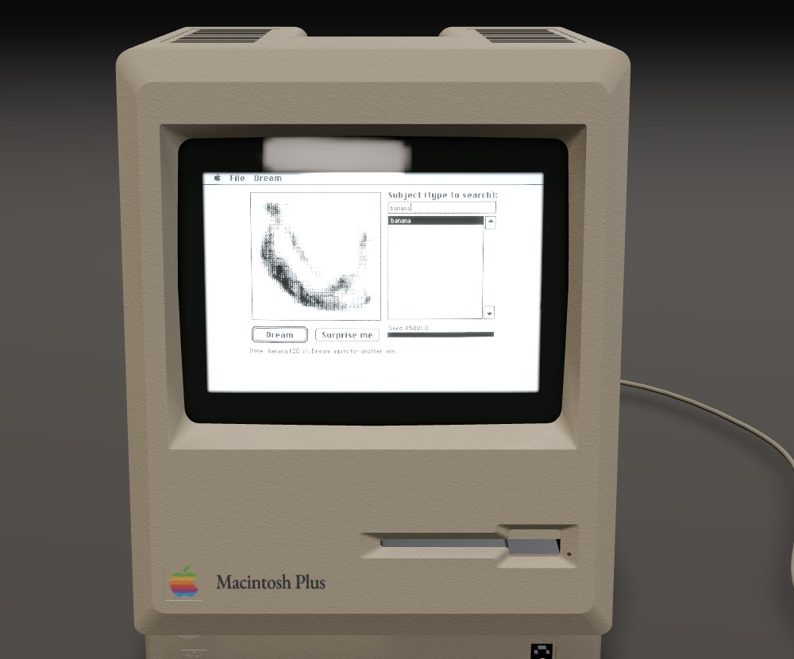
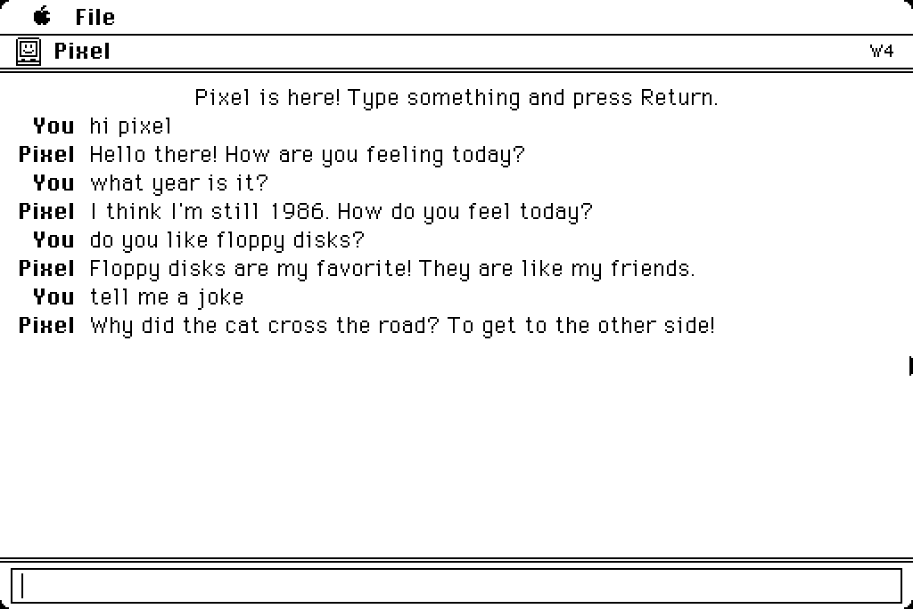
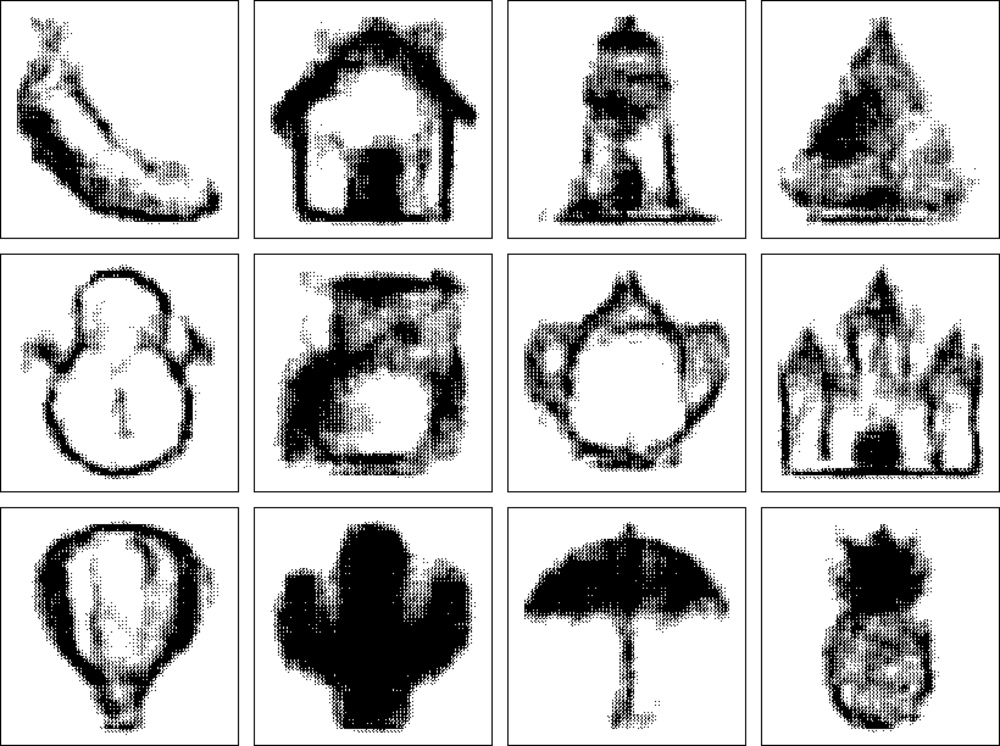
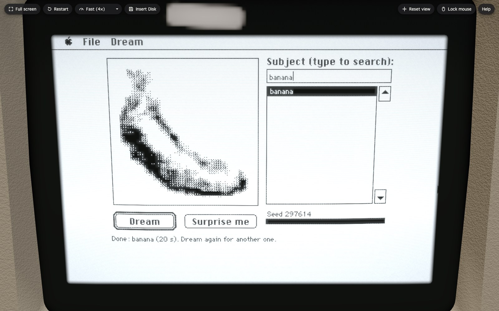
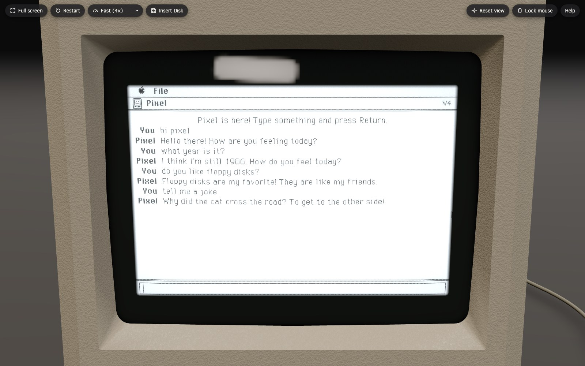

# A Macintosh Plus in your browser, and new software for a 1986 computer

**Try it: [macintosh.devon7y.com](https://macintosh.devon7y.com)** (desktop browser; nothing to
install). The story of the hardware: [Behind the Bezel](https://devon7y.github.io/macintosh_plus/).

This repository holds two things:

- **New programs for the Macintosh Plus** (1986: a 7.83 MHz Motorola 68000, no floating-point
  unit, 1–4 MB of RAM, a 512×342 black-and-white screen). Among them are two neural networks that
  run entirely on that machine:
  - **Pixel**, a 6.7-million-parameter chatbot.
  - **Dream**, a diffusion model that paints pictures from a word.
  
  There are also four games and apps, and a system extension.
- **The website** that runs a Mac Plus with these programs in a browser, inside a 3D model of the
  compact Mac with a simulated CRT, working keys and drive sounds.

Everything targets the real machines. Each program builds into bootable floppy images for a Mac Plus
(800K) and a Macintosh SE (1.44 MB). Timings below come from an emulator calibrated against the real
hardware.

---

## Pixel: a language model on a 68000

Pixel is a cheerful little Mac from 1986. It loves floppy disks, beeps when it's happy, thinks the
Chicago font is beautiful, is scared of magnets and isn't sure what year it is. The screenshot above
is a real conversation from the website: everything Pixel says is generated on the emulated 68000,
token by token.

- **Model:** a 6-layer transformer, width 160, grouped-query attention with ALiBi, and a
  4-expert mixture-of-experts feed-forward (one expert per token). **6,692,640 parameters**, 95% of
  them **ternary** (−1, 0, +1), with a 2,048-token vocabulary and a 64-token memory.
- **Data:** 1.39 million short chats written by Qwen2.5-7B-Instruct to a fixed persona, filtered
  down to 706K chats in a child-level vocabulary: 34 million tokens.
- **Training:** ternary quantization-aware training in the BitNet b1.58 style, 2.6 billion
  tokens, **62 minutes on one H100**.
- **On the Mac:** no multiplications by weights. Ternary matrix rows become table lookups over
  groups of 4 inputs, in generated 68000 assembly, with 16-bit integer arithmetic throughout.
  **About 0.2 tokens per second** on a real Mac Plus with 4 MB (0.3 in the emulator, which runs
  a Plus 1.5× too fast). The model is 1.42 MB, on two
  800K floppies.
- **Bit-exact:** the Mac produces exactly the tokens a Python reference predicts for the same seed.

**→ [Read more about Pixel](llm/README.md)**

## Dream: a diffusion model on a 68000

Type a subject and the Mac turns random static into a 64×64 picture in 16 shades of grey over six
denoising steps, redrawing after each one so you watch it develop. Every picture above was painted
on the website's emulated Mac Plus and is shown as the Mac draws it (3×3 halftone). Each is the
first try for its subject. A 13th subject, guitar, came out unrecognizable and isn't shown.

- **Model:** a U-Net that works on 4×4 pixel patches, from a 16×16 grid down to 2×2, with
  **about 0.9 million weights, nearly all ternary**. Integer-only, with no normalization layers.
  Guidance is distilled into the network, so each step is one pass.
- **Data:** 156,600 clip-art pictures of 261 subjects generated with FLUX 3 Image Klein, filtered
  with CLIP to 148,584, reduced to 64×64 in 16 greys.
- **Training:** a 52M-parameter float teacher, distilled into the small student for 6 steps with a
  loss over the whole sampler, then fine-tuned to the Mac's exact integer arithmetic.
- **On the Mac:** at start-up Dream **compiles its weights into 68000 machine code**. Each non-zero
  weight becomes one `add.w` or `sub.w`; zero weights cost nothing. That's 1.45 MB of generated
  code, and **about 1.6 minutes per picture** on a real Mac Plus. A 32×32 version runs on a 1 MB
  Plus in about 48 s.
- **Bit-exact:** PyTorch, a numpy reference, a C build and the Mac paint the same picture, bit for
  bit, for a given subject and seed.

The trained weights aren't in this repository: they derive from FLUX-generated pictures and are only
published on the website, under the FLUX Kommunity License. The code, data pipeline and training
scripts are all here. **→ [Read more about Dream](dream/README.md)**

## The website

[macintosh.devon7y.com](https://macintosh.devon7y.com) boots a 4 MB Mac Plus with System 6 in a few
seconds, with every program on the desktop.

- **Emulator:** Mini vMac in WebAssembly, run in a worker. Input, sound and disks pass through
  shared memory.
- **3D Mac:** a three.js model of the compact Mac, with the live screen on curved glass through a
  CRT shader (phosphor glow, afterglow, flicker, scanlines), studio reflections, soft shadows and a
  textured case. Drag to turn it, scroll to zoom.
- **Keyboard and mouse:** the 3D keys press as you type, and clicking them types on the Mac.
- **Insert Disk:** run your own classic Mac software. Drop a disk image or a `.sit`, `.hqx`,
  `.bin` or `.zip` archive, and it's unpacked in the browser and inserted as a floppy.

**→ [How the website works and how to build it](web/README.md)**

## Also in this repository

| Program | What it is | Mac |
| --- | --- | --- |
| [**Doodle**](paint/) | A MacPaint-style paint program with **Finish it**: sketch part of something, type what it is, and a 4-bit recurrent network (sketch-rnn style, trained on Google's *Quick, Draw!*) finishes the drawing stroke by stroke | 1 MB Plus |
| [**Blockworld**](blockworld/) | A first-person block-building game: walk, mine, place, craft, and save your world | 4 MB Plus, SE |
| [**Endurance**](racer/) | A pseudo-3D endurance racer in the spirit of *Enduro*: pass enough cars each day to keep racing | 1 MB Plus |
| [**Rail Runner**](runner/) | An endless runner on three lanes: jump, roll, hoverboard | 1 MB Plus |
| [**Narrow Screen**](narrowscreen/) | A System 6 extension and Control Panel that shrinks the usable screen, for a Plus whose CRT picture is too wide to see the edges ([the story](https://devon7y.github.io/macintosh_plus/)) | any |

Controls for all of them: [`CONTROLS.md`](CONTROLS.md).

Shared pieces:

- [`toolchain/`](toolchain/): setting up Retro68 (GCC for classic Macs), a template app, and
  `plus.h`, a small library for games (fast offscreen-to-screen copies, keys, frame pacing).
- [`mactools/`](mactools/): Python tools for MacBinary and resource forks, trimming System files,
  and building boot floppies.
- [`emu/`](emu/): a headless MAME test harness (`run_test.sh`) with a `SLOW` factor that matches
  real-hardware speed. MAME runs a Plus about 1.5× too fast because it skips video and sound DMA.
- [`transfer/`](transfer/): writing 1.44 MB floppies for a Macintosh SE from a Mac with a USB floppy
  drive (low-level format and write via UFI commands).

## Running on a real Mac

- **Mac Plus:** each program's disk script builds an 800K boot floppy with a trimmed System 6. Pixel,
  Dream and Blockworld need 4 MB of RAM. The Plus's 800K floppies can't be written by USB drives;
  use a vintage Mac, a floppy emulator, or a SCSI disk emulator such as BlueSCSI.
- **Macintosh SE (FDHD):** the `make_se_floppy.py` scripts build 1.44 MB boot floppies with System
  6.0.7. A USB floppy drive writes them (`transfer/ufi_format.py`).

## Building

You'll need [Retro68](https://github.com/autc04/Retro68) (see [`toolchain/README.md`](toolchain/README.md)),
`hfsutils`, Python 3 with numpy, MAME for the tests, PyTorch and a GPU for training, and Node for
the website. Each project folder has its own build script (`build_all.sh`, `build.py` or
`build_disk.py`).

Apple's ROMs and System software aren't included. The disk scripts expect your own copies at:

| Path | What |
| --- | --- |
| `emu/disks/system-6.0/6.0 System Tools.dc42` | System 6.0 System Tools disk (Disk Copy 4.2), for Mac Plus floppies |
| `emu/disks/system-6.0.7-tools.dc42` | System 6.0.7 System Tools disk, for SE floppies |
| `emu/disks/system-7.0.1/se7_base.hd` | an SE hard disk with System 7.0.1 (optional, for SE tests) |
| `emu/roms/` | MAME's `macplus` and `macsefd` ROM sets; `vMac.ROM` (Mac Plus ROM) for the website |

## How it was made

This was built in October 2026 by Claude (Anthropic) running as a team of Claude Code agents,
roughly one per project, with a manager agent assigning milestones and checking results. Devon set
the goals and tested on the real machines. The networks were trained on the Digital Research Alliance
of Canada's GPU clusters. The numbers in the READMEs come from measured runs. Real-hardware speeds
are emulator measurements slowed by a calibrated factor, and "bit-exact" means the token IDs or
pixels were compared.

## Licence

The code, art and weights here are released under the [MIT licence](LICENSE), except for the
third-party material listed in [`THIRD_PARTY.md`](THIRD_PARTY.md). Dream's trained weights are not
included (see above). Macintosh, Mac Plus and System 6 are Apple's; this project isn't affiliated
with Apple.
