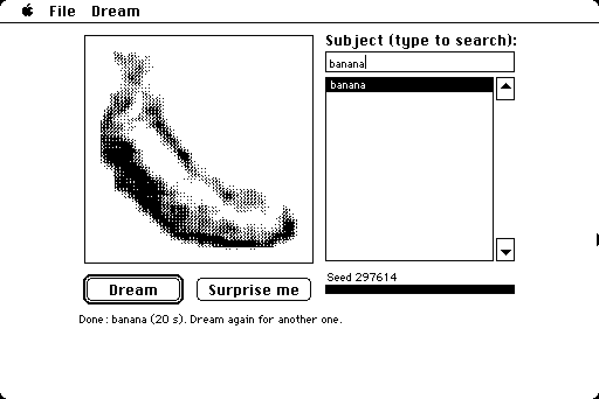

# Dream: a diffusion model that paints on a 1986 Macintosh Plus

Type a subject ("banana", "lighthouse", "teapot") and press Return. The Mac starts from random
static and, over six denoising steps, paints a 64×64 picture in 16 shades of grey, shown at 3× with a
1-bit halftone. Each step redraws the model's current guess, so you watch the picture develop. Dream
runs entirely on the Plus's 7.83 MHz 68000 with no FPU and no help from outside: about 1.6 minutes
per picture on real hardware.



Try it at **[macintosh.devon7y.com](https://macintosh.devon7y.com)**: double-click **Dream**, type a
subject, press Return. Return with an empty box picks a surprise.

## At a glance

| | |
| --- | --- |
| Pictures | 64×64, 16 grey levels, shown at 192×192 as 3×3 halftone cells |
| Subjects | 220 everyday things from the *Quick, Draw!* category list (`airplane` to `windmill`) |
| Network | a small U-Net on 4×4 pixel patches: **about 0.9M weights, nearly all ternary** (−1, 0, +1) |
| Sampling | 6 steps of deterministic DDIM, classifier-free guidance distilled into the network |
| Speed | ≈ 15 s per step, **≈ 97 s per picture** on a real Mac Plus (estimate), ≈ 84 s on an SE |
| Memory | 4 MB Plus: 1.45 MB of generated 68000 code plus tables; a 32×32 version runs on a 1 MB Plus (≈ 48 s) |
| Exactness | the Mac's pictures match the Python reference bit for bit |

## How it was made

### 1. A dataset of clip art

There was no suitable 1-bit clip-art dataset, so we generated one. **FLUX 3 Image Klein** (Black
Forest Labs, the step-distilled version) drew 512×512 pictures on H100 GPUs of the Digital Research
Alliance of Canada. The prompts were hand-written ("very simple, thick bold outlines, solid black
shapes, no shading"), with a centred layout box and rotating pose and view phrases
([`data_pipeline/`](data_pipeline/)).

- 261 subjects × 600 pictures = **156,600 generated**, about 12 H100-hours.
- Filters ([`filter.py`](data_pipeline/filter.py)): CLIP ViT-H-14 must rank the picture's own
  subject first, plus checks for near-copies, grey panels, frames, text and photos, and an NSFW
  classifier. **148,584 kept** (5.1% rejected), each reviewed on contact sheets.
- Each picture was cropped to the subject, padded square, area-downsampled to 64×64 (and 32×32) and
  quantized to 16 greys ([`process.py`](data_pipeline/process.py)).

### 2. A teacher, then a student the Mac can run

- **Teacher:** a 52M-parameter float diffusion model at 64×64 (v-prediction, cosine schedule,
  subject conditioning by per-channel scale and bias), 40,000 iterations on one A100
  ([`train/teacher.py`](train/teacher.py)).
- **Student:** the Mac-sized network, distilled from the guided teacher to **6 steps** with guidance baked in, so each step needs one network pass
  ([`train/distill.py`](train/distill.py)). It was trained with an end-to-end rollout loss over the
  whole 6-step sampler, then quantization-aware fine-tuned to the Mac's exact integer arithmetic
  ([`train/student.py`](train/student.py) has `float`, `qat` and `int` modes; `int` is the Mac).
- Pilot ablations showed quantization was the bottleneck. Two changes helped most: 4-bit weights in
  the first and last layers, and "two-term" power-of-two gains
  (`v = (acc >> k1) ± (acc >> k2)`) instead of a single shift ([`train/ablate.py`](train/ablate.py)).
- **Judged by eye**, as the Mac shows it. Subjects that most seeds drew unrecognizably were
  dropped: 41 of 261, mostly furry four-legged animals ([`app/drop_64.txt`](app/drop_64.txt)). On a fresh
  check of 40 of the remaining subjects × 4 seeds, about **93% were recognizable**. A
  nearest-neighbour check against the training set shows the student isn't copying its training
  pictures.

### 3. The network

[`engine/arch.py`](engine/arch.py) defines it as a flat "layer program" that the trainer, the Python
reference and the Mac all follow. The 64×64 picture becomes a 16×16 grid of 4×4 patches (16
channels). Three more levels halve the grid down to 2×2 and widen the channels (32, 64, 128, 192).
Every block is a depthwise 3×3 convolution, a 1×1 expansion with ReLU, and a 1×1 projection added
back into the residual stream. Activations are int16. Every layer ends in the same requantization:
a per-channel shift, then a per-step bias that carries the subject and the noise level, then a clamp
through a 65,536-entry table. Normalization layers are left out entirely.

### 4. Compiling the weights into 68000 code

Multiplying is slow on a 68000, and ternary weights don't need it. When Dream starts, it **compiles
each layer's weights into machine code** ([`engine/jit.py`](engine/jit.py) is the spec;
[`app/engine.c`](app/engine.c) and [`bench/jit.c`](bench/jit.c) are the Mac's compiler). For each
group of 7 output channels, kept in registers `d1`–`d7`, every input with a non-zero weight is loaded
once, and each weight becomes a single instruction:

```asm
move.w  (a0)+,d0        ; next input value
add.w   d0,d1           ; weight +1 for output channel 1
sub.w   d0,d4           ; weight -1 for output channel 4
                        ; weight 0: no instruction at all
```

Depthwise 3×3 taps compile the same way (`add.w d(a0),d1`). The trained network compiles to about
1.45 MB of straight-line code. Because zero weights cost nothing, a trained, sparse network runs
faster than a random one. The instruction encodings were checked against GNU `as`, and the Mac's
compiler against the Python spec.

### 5. Sampling, bit for bit

Noise comes from a seeded xorshift32 generator and Box–Muller tables in fixed point. The DDIM update
uses Q14 integer constants, and the display uses a contrast stretch and a fixed 3×3 halftone order.
All of it is specified in [`engine/FORMAT.md`](engine/FORMAT.md) and implemented in numpy in
[`engine/picture.py`](engine/picture.py). For a given subject and seed, the PyTorch student in
`int` mode, `picture.py`, the host build of the C engine and the real app in the emulator produce
**the same picture, bit for bit** ([`app/tests/`](app/tests/), [`app/test_host.py`](app/test_host.py)).

## Measured speed

| | per step | per picture (6 steps) | load |
| --- | --- | --- | --- |
| Mac Plus, 4 MB, 64×64 | 885 ticks ≈ 14.7 s | **≈ 97 s** | 55 s from floppy |
| Mac SE, 4 MB, 64×64 | 766 ticks ≈ 12.7 s | ≈ 84 s | 58 s |
| Mac Plus, 1 MB, 32×32 (191 subjects) | 435 ticks ≈ 7.2 s | ≈ 48 s | 28 s |

Measured in MAME, slowed 1.5× (Plus) or 1.3× (SE) to match real hardware. MAME leaves out the video
and sound DMA that steals CPU cycles on the real machines, and the factors were calibrated against
it. On the website, Mini vMac runs at 4× and a picture takes about half a minute.

## What's in this folder, and what isn't

| Path | What |
| --- | --- |
| [`data_pipeline/`](data_pipeline/) | prompts, generation with FLUX 3 Image Klein, filtering, processing, subject lists, Slurm scripts |
| [`train/`](train/) | teacher, distillation, the integer-exact student, evaluation, export to the Mac's `.drm` file |
| [`engine/`](engine/) | architecture, JIT spec, integer reference, model-file format, whole-picture reference |
| [`bench/`](bench/) | the 68000 benchmark that chose the architecture ([`RESULTS.md`](bench/RESULTS.md)) |
| [`app/`](app/) | the Mac app (Retro68 C plus the runtime compiler), disk builders, MAME tests |

**Not included: the trained weights and the generated training pictures.** Dream was trained on
pictures made with FLUX 3 Image Klein. Under the FLUX Kommunity License that makes Dream a
non-commercial Derivative of the FLUX model, so the weights and the FLUX-generated images aren't
redistributed here. Dream runs on the non-commercial website, which carries the licence
([`LICENSE-FLUX.md`](LICENSE-FLUX.md)), Black Forest Labs' attribution notice and the statement that
Dream is a modified work.

Dream is not an official Black Forest Labs product and is not endorsed by Black Forest Labs.

To train your own Dream you need access to FLUX 3 Image Klein (accept Black Forest Labs' licence on
Hugging Face) and a few dozen GPU-hours. [`train/hpc/full_pipeline.sh`](train/hpc/full_pipeline.sh)
runs teacher → student → evaluation; `train/export.py` writes the Mac's model file. Without
trained weights you can still build and run the app: `build_all.sh` falls back to random test
models (`engine/model_file.py random A64L2Q <out.drm>`), which paint noise but exercise every code
path.

## Building the app

You need [Retro68](https://github.com/autc04/Retro68), `hfsutils`, Python 3 with numpy, and MAME for
the tests. Apple's System software isn't included (see the top-level README).

```sh
dream/app/build_all.sh [dream64.drm] [dream32.drm]
# -> dream/build/app/Dream.bin (4 MB, compiled layers) and DreamSm.bin (1 MB, lookup tables),
#    dream/build/release/dream.img (800K floppy, 4 MB Plus) and dream_1mb.img (1 MB Plus)
python3 dream/app/make_se_floppy.py --model <dream64.drm>   # 1.44 MB boot floppy for an SE
```
